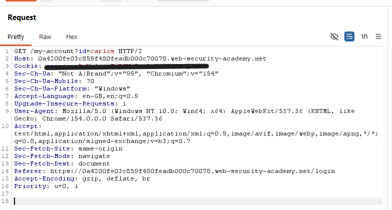
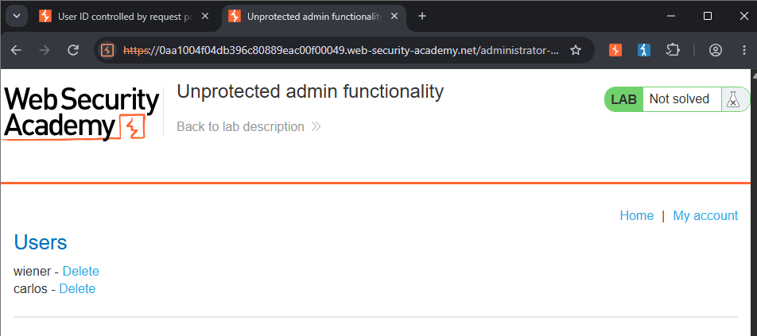

# Lab 3 — Broken Access Control (IDOR & unprotected admin panel)

Two PortSwigger Web Security Academy labs exploited and analysed with **Burp Suite** (Proxy, HTTP history, Repeater), with server-side fixes and regression tests.

📄 Full report (French): [`TP3_Broken_Access_Control_report.pdf`](TP3_Broken_Access_Control_report.pdf) · LaTeX source: [`rapport_tp3.tex`](rapport_tp3.tex)

## Scenario 1 — Horizontal access control / IDOR

*Lab: User ID controlled by request parameter*

Logged in as `wiener`, the account page is `GET /my-account?id=wiener`. Replacing the parameter with `carlos` — same session cookie — returns Carlos's account and API key:

```
GET /my-account?id=wiener   -> 200 OK (3802 bytes)
GET /my-account?id=carlos   -> 200 OK (3802 bytes)   # same session
```

**Root cause:** the server trusts a client-supplied identifier instead of the identity in the session.
**Fix:** derive the user from the session, check resource ownership, deny by default (403/404).



## Scenario 2 — Vertical access control / unprotected admin function

*Lab: Unprotected admin functionality*

`/robots.txt` disclosed `Disallow: /administrator-panel`. The panel answered **200 to an anonymous visitor** and deleted a user through a simple GET:

```
GET /my-account                                  -> 302 to /login   (not authenticated)
GET /administrator-panel                         -> 200 OK          (no check!)
GET /administrator-panel/delete?username=carlos  -> 302 Found
```

**Root cause:** "security through obscurity" — a hidden link is not an access control.
**Fix:** role check on every admin route (centralised middleware), deny by default, sensitive actions as POST with anti-CSRF token.



## Summary

| | IDOR (horizontal) | Unprotected admin (vertical) |
|---|---|---|
| Impact C / I / A | High / Low–Medium / None | Medium / High / High |
| Expected behaviour | 403/404 when `id` ≠ session user | 401 anonymous, 403 non-admin |
| Regression test | Two accounts, cross-access request must fail | Each admin route tested as anonymous, user, admin |

All tests were performed only in PortSwigger's authorised lab environment. Cookies and API keys are masked in the screenshots.

*The `.tex` source uses a custom document class that is not included; the PDF is the readable version.*
